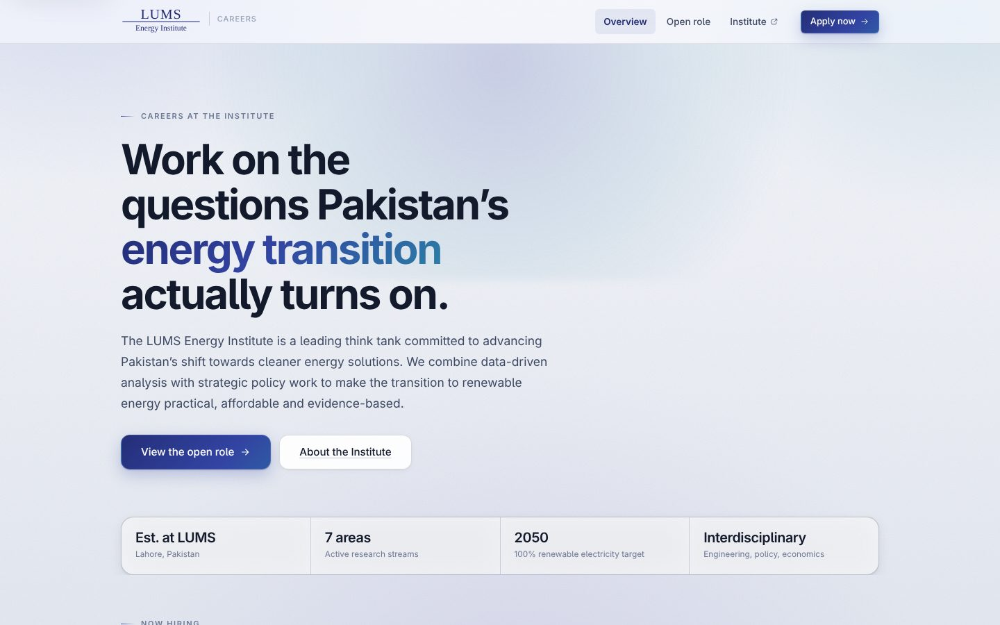
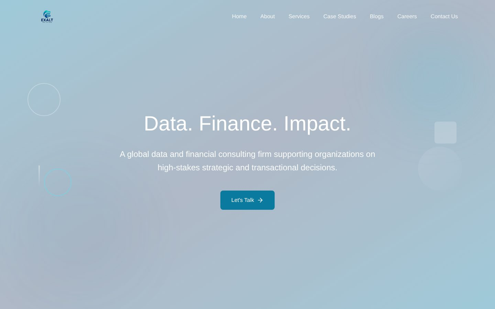

# Syed Safiullah Khalid | Selected Projects

Full stack developer based in Lahore, Pakistan, with a Computer Science degree from LUMS.
I build production web apps end to end: React and Next.js frontends, Supabase and Node backends, auth and role based access, offline first PWAs, and the deployment around them.

This repo showcases seven projects. Most are client or employer work, so their source code is private. Each project has its own page covering what it does, how it is built and what I was responsible for. Code walkthroughs are available on request.

  
  
  
  
  
  
  
  
  
  
  

---

## Projects at a glance

| # | Project | What it is | Stack | Status |
|---|---|---|---|---|
| 1 | [LEI Hiring Portal](projects/lei-hiring-portal.md) | Careers site and applicant tracking system for the LUMS Energy Institute | React, Vite, Supabase | Live |
| 2 | [GB Energy Market Survey](projects/gb-energy-survey.md) | Offline first field survey app, 887 fields across 4 questionnaires | React, IndexedDB, Supabase, PWA | Deployed |
| 3 | [Exalt Solutions Website + Portal](projects/exalt-website.md) | Company website with an admin portal for content and HR | React 19, Tailwind v4, Supabase | Live |
| 4 | [Exalt BD Portal](projects/exalt-bd-portal.md) | Internal tool that automates a sales team's outreach workflow | React, Supabase Edge Functions | Internal |
| 5 | [InfraGreen Website](projects/infragreen.md) | Site for a climate tech company working on hydronic radiant cooling | Next.js, TypeScript, Framer Motion | Live |
| 6 | [LUMS Masjid App](projects/lums-masjid.md) | Prayer times, Ramadan schedule and events for the campus mosque | React Native (Expo), Supabase | Live |
| 7 | [Fleeto](projects/fleeto.md) | Campus delivery platform for food, groceries and pharmacy (team project) | Next.js, MongoDB, Stripe, Google Maps | Course project |

---

## 1. LEI Hiring Portal
**Careers site + applicant tracking system for the LUMS Energy Institute**

Public job pages with a four step application form and CV upload, plus a private team portal with a drag and drop pipeline board, ratings, notes and an activity log. Applicant data is protected at the database level, not just hidden in the UI.

**Live:** [lei-recruiting.vercel.app](https://lei-recruiting.vercel.app) · [Read more →](projects/lei-hiring-portal.md)

---

## 2. GB Energy Market Survey
**Offline first data collection app for a field study in Gilgit-Baltistan and Chitral**

Replaced four paper questionnaires (887 fields, every question type from Likert grids to equipment inventories) for enumerators working for weeks without signal. Answers save on the phone as they are typed, sync safely when a connection appears, and the coordinator gets live stats, central control over essential questions, Excel export with a full codebook, and on device PDF generation.

**[Read more →](projects/gb-energy-survey.md)**

 

---

## 3. Exalt Solutions Website + Portal
**Website for a data and financial consulting firm, with a built in admin portal**

Public site (services, case studies, blog, careers, contact) and a private portal where staff manage portfolio items, job posts and applicants, team members, client logos and HR records, with per user permissions.

**Live:** [exaltsolutions.co](https://exaltsolutions.co) · [Read more →](projects/exalt-website.md)

---

## 4. Exalt BD Portal
**Turns a manual sales outreach routine into a supervised, automated pipeline**

Campaigns, a review queue where a person approves every message, personalized templates, duplicate contact warnings across the team, WhatsApp messaging with scheduled follow ups, daily goal tracking, reports and role based access. Background jobs run as serverless functions, so there is no separate server to maintain.

**[Read more →](projects/exalt-bd-portal.md)**

---

## 5. InfraGreen Website
**Website for a Pakistani climate tech company**

Single page Next.js site presenting InfraGreen's hydronic radiant cooling and green retrofit services, its live deployment at the LUMS Kargah Lab, team and partnerships, built with a set of custom animation components.

**Live:** [infragreen.vercel.app](https://infragreen.vercel.app) · [Read more →](projects/infragreen.md)

---

## 6. LUMS Masjid App
**Campus mosque companion app, built on my own time**

Daily prayer times, a Ramadan sehri and iftar table, and upcoming talks and sessions, all editable from an in app admin panel. Sign up is limited to university email addresses, and the same Expo codebase runs on mobile and as an installable web app.

**Live:** [lums-masjid.vercel.app](https://lums-masjid.vercel.app) · [Read more →](projects/lums-masjid.md)

 

---

## 7. Fleeto
**Campus delivery platform for food, groceries and pharmacy (6 person course project, I was the top contributor)**

Platform with customer, shop owner and admin dashboards: email verified sign up, carts and checkout, live order tracking on Google Maps, a Stripe powered "Fleeto Pro" subscription, a coins system, ratings and feedback, and an AI food assistant.

**[Read more →](projects/fleeto.md)**

---

## Contact

**Syed Safiullah Khalid** | Full stack developer
Email: [syedsafiullahkhalid@gmail.com](mailto:syedsafiullahkhalid@gmail.com)
LinkedIn: [linkedin.com/in/syed-safiullah-khalid-a43562247](https://www.linkedin.com/in/syed-safiullah-khalid-a43562247)
Portfolio: [syedsafiullah-resume.vercel.app](https://syedsafiullah-resume.vercel.app)
