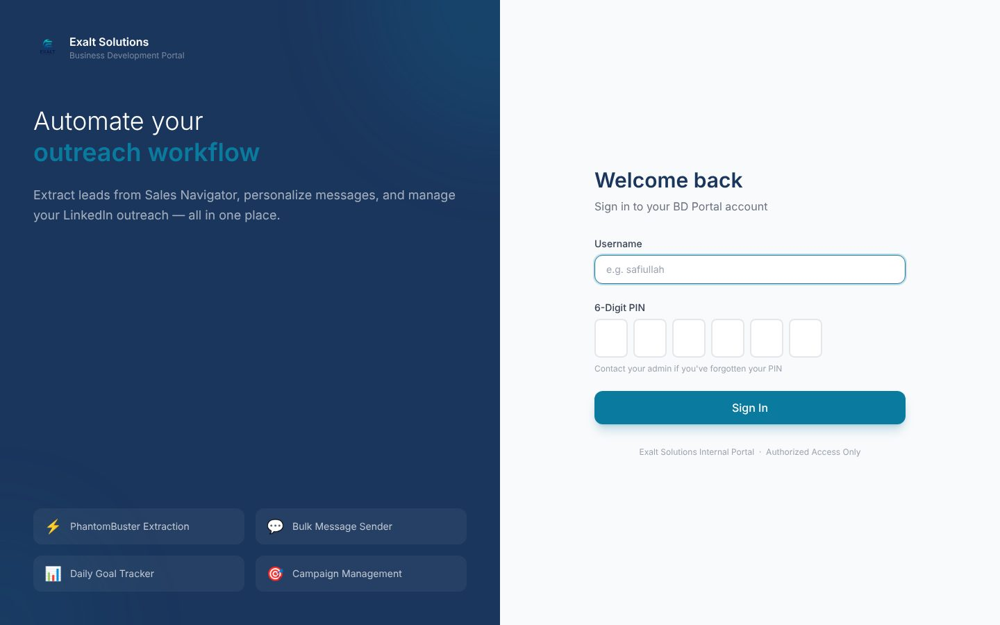

# Exalt Solutions: Business Development Portal

[← Back to all projects](../README.md)

**Client:** Exalt Solutions (internal tool for the BD team)
**My role:** Designed the workflow and built the system
**Stack:** React (Vite), Tailwind CSS, Framer Motion, Supabase (Postgres, Auth, Edge Functions), PhantomBuster API, WhatsApp Business API
**Access:** Internal

## The problem
The BD team ran its outreach by hand: building lead lists, writing each message, tracking daily targets in a spreadsheet, and occasionally contacting the same prospect twice.

## What I built
A portal where each team member sets a few parameters and the system handles the repetitive work, with a person approving what goes out.

- **Campaigns:** define a target audience and import leads into a shared prospect list
- **Review queue:** approve each outreach step before it is sent
- **Duplicate check:** warns if a colleague has already contacted the same prospect
- **Templates:** reusable messages with personalization fields filled per lead
- **WhatsApp module:** import contact lists from CSV, send template messages, schedule follow ups, view history
- **Dashboard and reports:** daily goals per person and campaign progress
- **Admin:** role based access and user management

## Engineering highlights
- No separate server to host: background work such as sending messages and processing scheduled follow ups runs in Supabase Edge Functions
- Third party credentials are used only on the server side, never in the browser
- Human in the loop by design: automation prepares everything, nothing goes out without approval
