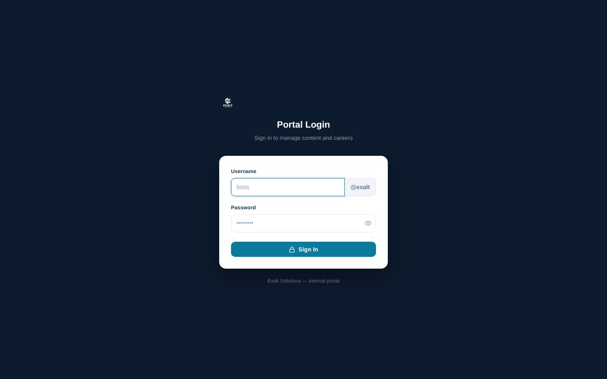

# Exalt Solutions: Website + Content Portal

[← Back to all projects](../README.md)

**Client:** Exalt Solutions, a data and financial consulting firm (where I work part time as a software engineer)
**My role:** Sole developer of the website and its admin portal
**Live:** [exaltsolutions.co](https://exaltsolutions.co)
**Stack:** React 19, Vite 7, Tailwind CSS v4, Framer Motion, Supabase, Vercel

## What I built

### Public website
Home, About, Services, Case Studies, Blogs, Careers and Contact pages, with animated sections, client and partner showcases, testimonials, a blog system and SEO metadata.

### Admin portal
The same app includes a private portal where the team manages the site without touching code: portfolio items, job posts and applicants, team members and client logos, plus internal HR records for management.

## Engineering highlights
- Custom login with per user permissions: each staff member only sees the sections they have been granted, and management controls accounts from inside the portal
- Data access secured at the database level, so the public site cannot read or change portal data
- One clean data layer for all backend calls, and the schema versioned as ordered migrations
- Handover documentation covering architecture and how to extend the portal
