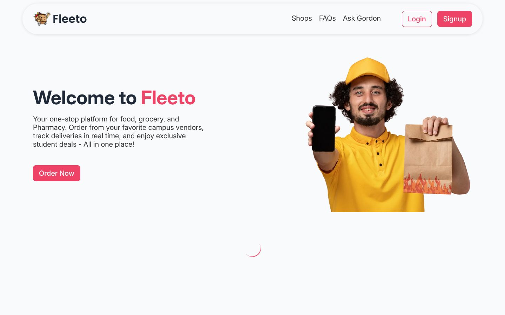

# Fleeto: Campus Delivery Platform

[← Back to all projects](../README.md)

**Context:** Software Engineering course project at LUMS, team of 6
**My role:** Top contributor by commits; full stack work across the app, APIs and payment server
**Stack:** Next.js, TypeScript, MongoDB (Mongoose), NextAuth, Nodemailer, Stripe, Google Maps API, Express, LLM API

## What it does
A one stop delivery platform for students to order food, groceries and medicine from campus vendors.

- **Customers:** email verified sign up, browse restaurants, grocery stores and pharmacies, cart and checkout, live order tracking on a map, ratings and feedback
- **Shop owners:** their own login and dashboard to manage menus, items and shop details
- **Admins:** dashboard to onboard shops, manage FAQs and review feedback
- **Fleeto Pro:** a monthly subscription paid through Stripe, plus an in app coins system
- **Ask Gordon:** an AI food assistant that recommends what to order

## Engineering highlights
- Three account types (customer, shop, admin) with protected routes
- API routes in Next.js for shops, menus, orders, coins, feedback and subscriptions
- A separate Express server for Stripe payments and subscriptions
- Google Maps integration for addresses and order tracking
