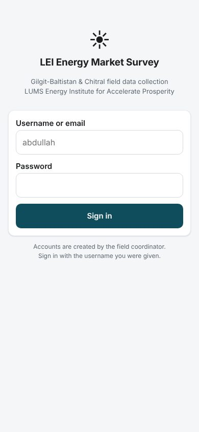

# GB Energy Market Survey: Offline Field Data Collection

[← Back to all projects](../README.md)

**Client:** LUMS Energy Institute, for a market assessment of energy sector innovations in Gilgit-Baltistan and Chitral
**My role:** Sole developer: turning the paper instruments into an app, offline sync, admin tools, exports
**Stack:** React (Vite), IndexedDB (Dexie), Service Worker / PWA, Supabase, Recharts, SheetJS, jsPDF
**Access:** Internal tool for the field team

## The problem
Enumerators had to collect household, business, hospitality and supply chain surveys in mountain districts where there is often no signal for days. Paper forms were slow, error prone and had to be typed up afterwards.

## What I built
An installable app that works fully offline for weeks and syncs when a connection appears.

| Instrument | Fields |
|---|---|
| Survey A: Residential Energy Market | 226 |
| Survey B: Commercial Establishments | 239 |
| Survey C: Hospitality and Tourism | 197 |
| Survey D: Energy Equipment Supply Chain | 225 |
| **Total** | **887 fields** |

Every question type from the paper forms is reproduced: single and multi select, Likert grids, rankings, percentage tables that must total 100, seasonal number grids, free text tables and large equipment inventories.

### For enumerators
- Sign in once, then use the app offline indefinitely
- Module chips showing untouched, partial and complete sections
- IDs, dates and names fill in automatically
- Missing essential questions are listed as tappable links rather than blocking completion
- Save any completed survey as a PDF, generated on the phone

### For the coordinator
- Dashboard with every response from all enumerators, filters and full record view
- Stats by survey type, enumerator, district and day, plus a chart for any question
- Mark which questions are essential centrally; phones pick it up when next online
- Create enumerator accounts from inside the app
- Excel export with one sheet per survey and a full codebook of all 887 variables

## Engineering highlights
- **Nothing is lost.** Answers save to on device storage continuously, including when the app is backgrounded or the phone sleeps.
- **Reliable sync.** Records upload one by one and are only marked done when the server confirms, so retries are always safe.
- **Updates reach installed apps** without interrupting an interview in progress.
- **Schema as data.** The four instruments are plain data files that drive the forms, validation, exports and stats, so changing a question needs no other code changes.
