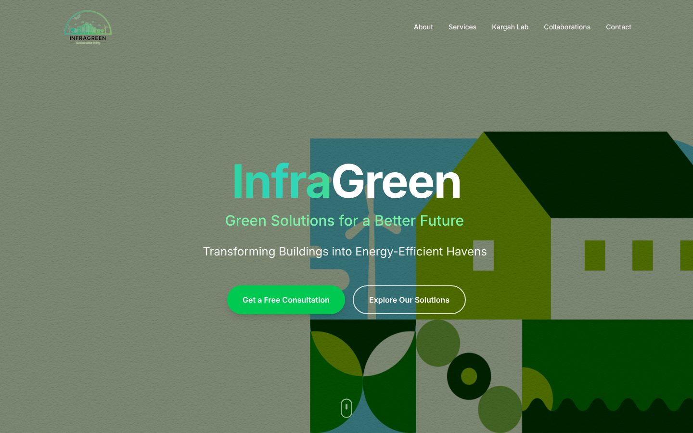

# InfraGreen Solutions: Company Website

[← Back to all projects](../README.md)

**Client:** InfraGreen Solutions, a Pakistani climate tech company working on hydronic radiant cooling and green building retrofits (where I work as a sustainability analyst and software engineer)
**My role:** Built the website
**Live:** [infragreen.vercel.app](https://infragreen.vercel.app)
**Stack:** Next.js (App Router), TypeScript, Tailwind CSS, Framer Motion, Vercel

## What I built
A single page site that explains a technical product to clients, partners and funders:
- **Hero** with illustrated artwork and calls to action
- **About** with the company's mission, vision and team
- **Services:** green building design, hydronic radiant cooling, energy audits and retrofits
- **Kargah Lab:** the live deployment of the cooling system at the LUMS Kargah Research Lab
- **Impact**, **Collaborations** and **Contact** sections

## Engineering highlights
- A small library of reusable animation components: scroll progress bar, word, letter and blur reveals, animated counters and progressive blur
- Smooth section navigation with active link tracking
- Fully typed with TypeScript and deployed on Vercel
