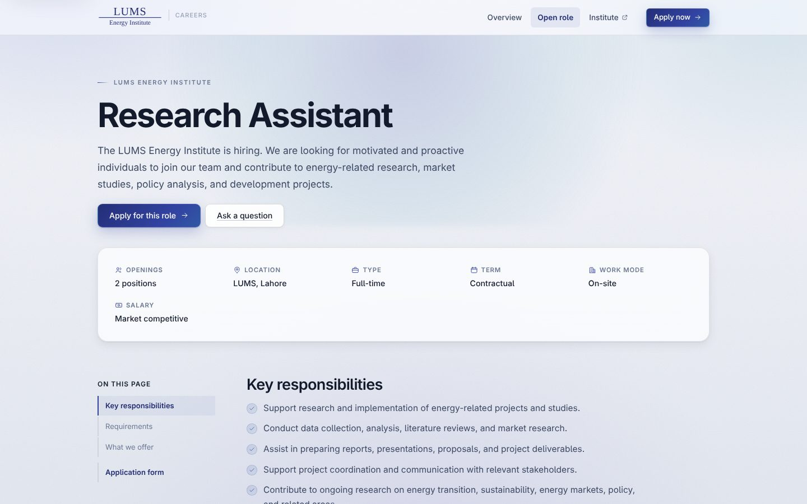

# LEI Hiring Portal

[← Back to all projects](../README.md)

**Client:** LUMS Energy Institute (LEI), Lahore
**My role:** Sole developer: design, frontend, database, deployment
**Live:** [lei-recruiting.vercel.app](https://lei-recruiting.vercel.app)
**Stack:** React (Vite), React Router, Supabase (Postgres, Auth, Storage), Vercel

## The problem
The Institute was hiring through email and spreadsheets. It needed a proper careers page that candidates could apply through, and a private place where the hiring team could review, rate and move applicants through stages together.

## What I built

### Public careers site
- Landing page about the Institute, its focus areas and why to join
- Job description page with a sticky "on this page" navigation rail
- Four step application form with CV upload
- Friendly validation: email typo suggestions, phone number formatting as you type, live word counters on written answers, readable duplicate application messages

### Private team portal
- Pipeline board with drag and drop between stages, plus a table view
- Applicant drawer with the full application, CV, notes and activity history
- Star ratings, assignment and archiving
- Admin and reviewer roles

## Engineering highlights
- Access control enforced in the database, not only in the UI, so applicant data stays private even though the site is a static app
- Private CV storage, an automatic activity log of every change, and staff only access to the portal
- Content as data: the job description lives in one file, and the schema already supports several open roles at once
