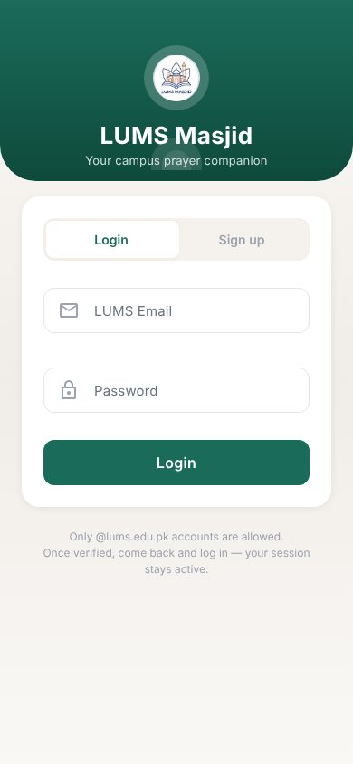

# LUMS Masjid App

[← Back to all projects](../README.md)

**For:** The LUMS campus mosque. A personal project, built as a way of giving back.
**My role:** Sole developer
**Live:** [lums-masjid.vercel.app](https://lums-masjid.vercel.app)
**Stack:** React Native with Expo and Expo Router, TypeScript, React Native Paper, Supabase, PWA web build on Vercel

## What it does
- **Home:** today's prayer times for the campus mosque
- **Ramadan:** sehri and iftar times for the month, with today highlighted
- **Sessions:** upcoming talks and gatherings with date, time and audience
- **Admin panel:** mosque admins update timings and manage sessions from inside the app

## Engineering highlights
- **One codebase, mobile and web.** Built with Expo, so the same code runs as a native app and as an installable web app.
- **Campus only sign up** using university email addresses.
- **Role based editing** for students and admins, enforced on the backend as well as in the UI.
- **Typed data layer** with small hooks that keep the screens simple.
